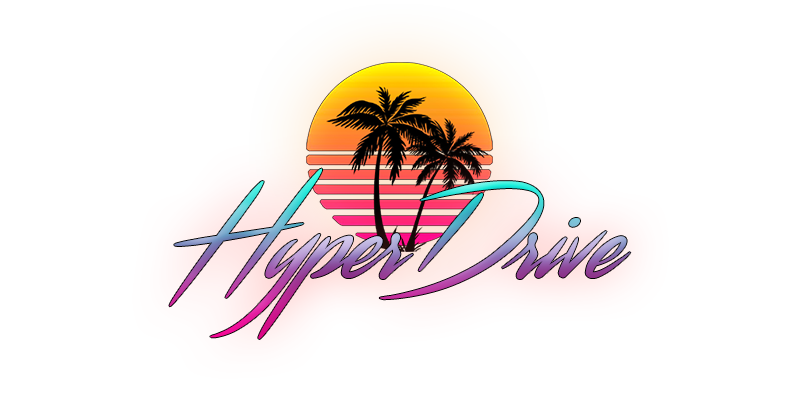

---

HyperDrive es un entorno en primera persona, en el que el usuario conduce por un tramo de carretera infinito escuchando música retrowave. Todo el proyecto está construido alrededor de [Three.js](https://threejs.org/), una biblioteca JavaScript 3D ligera con un renderizador WebGL.

## Controles

Los usuarios pueden hacer clic en cualquier parte de la escena para bloquear el puntero y mover la cámara. En cualquier momento, el usuario puede pulsar la tecla `Esc` para quitar el bloqueo. En la esquina inferior derecha, hay dos botones que reproducen/pausan la música en el entorno o ajustan el volumen de la música.
